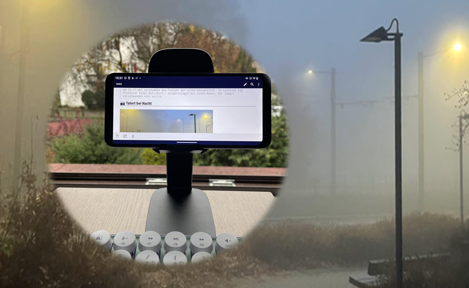
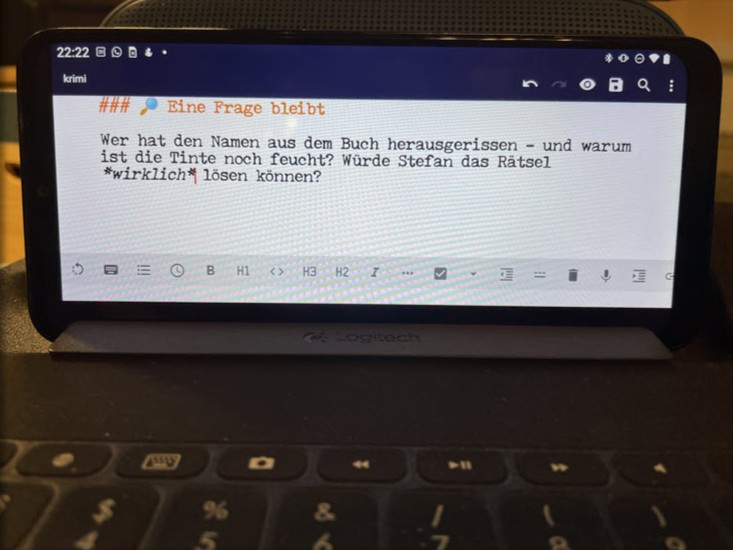

[Zurück zu index.md](../index.md)

> **Der beste Grund, einen eigenen "Tatort" zu schreiben.**

# Alte Smartphones als Markdown-Schreibmaschinen nutzen

> **In vielen Haushalten liegen alte Handys herum.  
Diese Handys werden nicht mehr benutzt.  
Oft liegen sie in einer dunklen Ecke.**

**Alte Handys kann man nicht mehr gut benutzen.**  
Der Akku vom alten Handy ist oft kaputt.  
Man kann keine neuen Programme mehr auf das Handy laden.  
Das Handy hat zu wenig Speicher.  
Speicher ist der Platz für Bilder, Videos oder Apps.

Das Handy bekommt keine neuen Programme vom Hersteller.  
Diese Programme nennt man Updates.  
Das kann gefährlich sein.  
Ohne Updates kann jemand deine Daten stehlen.  
Ohne Updates kann jemand dein Handy kaputt machen.

Vielleicht funktioniert das Handy sonst noch gut.  
Zum Beispiel das Display.  
Das ist der Bildschirm vom Handy.

**Dann kann man das Handy für etwas anderes benutzen.**  
Zum Beispiel als Schreibmaschine.  
Mit einer Schreibmaschine schreibt man Texte.  
So kann man das alte Handy sinnvoll nutzen.

*Schreiben wie mit einem Laptop? - Nein, das Hochformat ist günstiger.*

### Ohne Ablenkung schreiben

**Wenn man das Gerät ohne Internet benutzt,  
nennt man das offline.**

Nur die Text-Anwendung ist noch da.  
Alle anderen Apps sind gelöscht oder ausgeschaltet.  
Deshalb funktioniert nur die Text-Anwendung.  
Sie können keine anderen Apps nutzen.  
Das ist anders als bei einem normalen Smartphone.  
Bei einem normalen Smartphone gibt es viele andere Apps.  
Man ist dann oft abgelenkt.  
Mit diesem Gerät passiert das nicht so schnell.  
Sie kommen nicht in Versuchung, auf andere Apps zu klicken.

### Markdown für die Texteingabe

**Markdown hat viele Vorteile auf dem Handy:**

1. Du brauchst keine großen Menüs.  
Du brauchst keine Symbole.  
Du hast mehr Platz auf dem Bildschirm.  
Du kannst Text besser eingeben.  

2. Du brauchst keine Maus.  
Du kannst deine Hände auf der Tastatur lassen.  
Markdown benutzt stattdessen Zeichen.  
Zum Beispiel ein „#“ für Überschriften.  
Mit diesen Zeichen kannst du den Text gut ordnen.  

3. Du kannst jeden Text-Editor benutzen.  
Markdown funktioniert in vielen Programmen.  
Du bist nicht an ein bestimmtes Programm gebunden.  
Aber ein Markdown-Editor bringt einige Vorteile.

- [Quelle](https://gnulinux.ch/markdown-schreibmaschine) (Originalartikel und Fotos von Herbert Hertramph)

[weiter](040_Dingsi.md)
